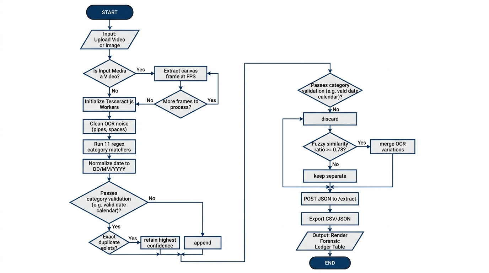

# Vision Extract — Program Logic Flowchart

This document provides the standard **ISO/ANSI Program Logic Flowchart** for Vision Extract, structured with standard symbols:
- **Ovals `([ ... ])`**: Start and End Terminals.
- **Parallelograms `[/ ... /]`**: User Input and System Output operations.
- **Rectangles `[ ... ]`**: Processing and computation steps.
- **Diamonds `{ ... ? }`**: Conditional decision branches (`Yes` / `No`).

---

## 🖼️ Program Logic Flowchart (Visual Diagram)



---

## 📊 ANSI/ISO Program Logic Flowchart

```mermaid
flowchart TD
    %% Standard Flowchart Shapes & Styles
    classDef terminal fill:#1E293B,stroke:#0F172A,stroke-width:2px,color:#FFFFFF,font-weight:bold;
    classDef io fill:#EDE9FE,stroke:#7C3AED,stroke-width:2px,color:#5B21B6;
    classDef process fill:#F0FDF4,stroke:#16A34A,stroke-width:2px,color:#166534;
    classDef decision fill:#FEF3C7,stroke:#D97706,stroke-width:2px,color:#92400E;

    %% Flowchart Nodes
    StartNode([START]):::terminal
    InputMedia[/Input: User selects Video or Image file/]:::io
    CheckIsVideo{Is file a Video?}:::decision

    %% Video branch
    InitVideo[Initialize HTML5 Video Element & Canvas]:::process
    SetFPS[Calculate step interval based on selected FPS]:::process
    SeekFrame[Seek video.currentTime to next frame]:::process
    DrawCanvas[Draw frame on offscreen Canvas]:::process
    RunWorker[Tesseract.js WASM reads text & confidence]:::process
    CheckMoreFrames{More video frames to extract?}:::decision

    %% Image branch
    OcrImage[Run Tesseract.js directly on image file]:::process

    %% Network & Backend
    PackagePayload[Package frames list into JSON payload]:::process
    PostAPI[/HTTP POST /extract to Flask API/]:::io
    CleanOCR[_clean_ocr: Repair OCR artifacts, pipes |, spaces in emails, digit confusions]:::process
    RunRegex[Match 11 regex categories: Email, Phone, Date, UPI, GST, PAN, etc.]:::process
    CheckValidator{Passes category validator?}:::decision
    DiscardItem[Discard invalid match]:::process
    NormDate[Normalize dates to canonical DD/MM/YYYY]:::process

    %% Deduplication
    CheckExactDupe{Exact normalized match in ledger?}:::decision
    KeepHighestConf[Retain entry with highest confidence]:::process
    AppendItem[Append item to candidate list]:::process

    %% Fuzzy clustering
    CheckIsEmailOrUPI{Category is Email or UPI?}:::decision
    CheckFuzzy{SequenceMatcher similarity >= 0.78?}:::decision
    MergeFuzzy[Merge OCR corrupted variations into best quality entry]:::process
    KeepSeparate[Keep as independent entity]:::process

    %% Output & End
    BuildJSON[Compile final response: items, counts, by_category]:::process
    RenderTable[/Output: Render Forensic Ledger Table with Badges/]:::io
    EndNode([END]):::terminal

    %% Connections
    StartNode --> InputMedia
    InputMedia --> CheckIsVideo

    %% Video processing loop
    CheckIsVideo -->|Yes| InitVideo
    InitVideo --> SetFPS
    SetFPS --> SeekFrame
    SeekFrame --> DrawCanvas
    DrawCanvas --> RunWorker
    RunWorker --> CheckMoreFrames
    CheckMoreFrames -->|Yes| SeekFrame
    CheckMoreFrames -->|No| PackagePayload

    %% Image single shot
    CheckIsVideo -->|No| OcrImage
    OcrImage --> PackagePayload

    %% Backend processing
    PackagePayload --> PostAPI
    PostAPI --> CleanOCR
    CleanOCR --> RunRegex
    RunRegex --> CheckValidator

    CheckValidator -->|No| DiscardItem
    CheckValidator -->|Yes| NormDate
    NormDate --> CheckExactDupe

    CheckExactDupe -->|Yes| KeepHighestConf
    CheckExactDupe -->|No| AppendItem

    KeepHighestConf --> CheckIsEmailOrUPI
    AppendItem --> CheckIsEmailOrUPI

    CheckIsEmailOrUPI -->|Yes| CheckFuzzy
    CheckIsEmailOrUPI -->|No| BuildJSON

    CheckFuzzy -->|Yes| MergeFuzzy
    CheckFuzzy -->|No| KeepSeparate

    MergeFuzzy --> BuildJSON
    KeepSeparate --> BuildJSON

    BuildJSON --> RenderTable
    RenderTable --> EndNode
```

---

## 📐 Shape Specification Table

| Flowchart Symbol | Shape | Usage in Vision Extract |
| :--- | :--- | :--- |
| **Terminal** | Oval `([ ... ])` | `START` (application opened) and `END` (ledger rendered). |
| **Input / Output** | Parallelogram `[/ ... /]` | `Input Media Selection` and `Render Ledger Table`. |
| **Process** | Rectangle `[ ... ]` | Canvas extraction, Tesseract OCR, regex matching, date normalization, sorting. |
| **Decision** | Diamond `{ ... ? }` | If/Else conditions: `Is Video?`, `More frames?`, `Valid regex/date?`, `Exact duplicate?`, `Fuzzy ratio >= 0.78?`. |
