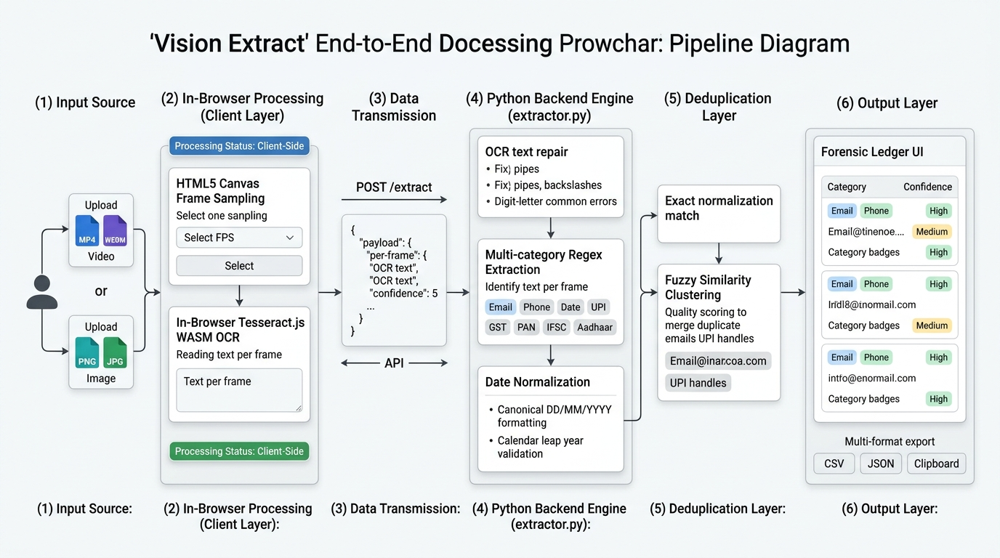

# Vision Extract 🔍

**Vision Extract** is an in-browser forensic data extraction tool for video and document media. It uses client-side WebAssembly (WASM) OCR via **Tesseract.js** to extract and normalize contact details, financial identifiers, dates, and government IDs without uploading heavy video files to external servers.

---

## 🏛️ System Architecture Flowchart



---

## ⚡ Key Capabilities

- **In-Browser Privacy**: Video frames are sampled and read inside the browser using HTML5 Canvas and Tesseract.js WASM workers. Video files never leave your machine.
- **Structured Field Extraction**:
  - **Emails**: Normalized domains, OCR space repair (`user @ domain . com` $\rightarrow$ `user@domain.com`).
  - **Dates**: Standardized into `DD/MM/YYYY`, supporting numeric formats, ISO formats, space-delimited dates, and written months (`July 6, 2026`, `28th Sept 2026`). Strict calendar validation eliminates invalid dates.
  - **Financial & Identity**: Indian Phone numbers (`+91`), UPI IDs, GST, PAN, IFSC codes, Aadhaar numbers, and Amounts.
- **Two-Stage Deduplication**:
  1. Exact normalization match (preserves highest confidence).
  2. Fuzzy similarity clustering (`difflib.SequenceMatcher`) to collapse OCR typographical errors across multiple video frames.
- **Forensic Ledger**: Interactive table with instant filtering, sorting, category badges, and export to CSV, JSON, and Clipboard.

---

## 🚀 Quick Start

To run the project locally on your machine, follow the instructions in [**`run.md`**](run.md):

```cmd
cd "C:\Users\haasi\OneDrive\Documents\Mini Project"
.venv\Scripts\activate
pip install -r requirements.txt
python app.py
```

Then visit **`http://127.0.0.1:5000`** in your browser.