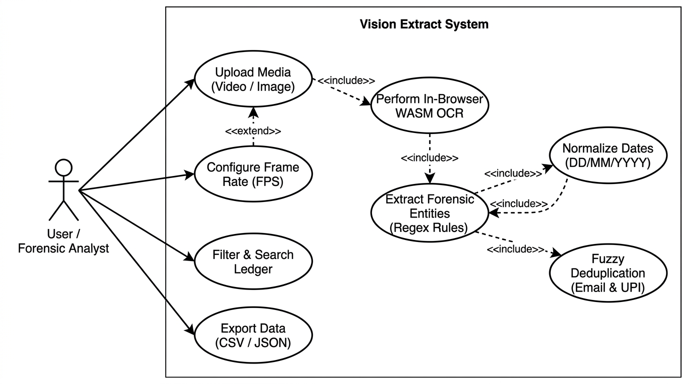
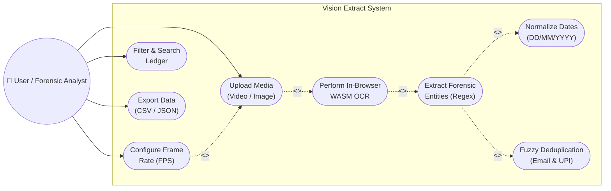
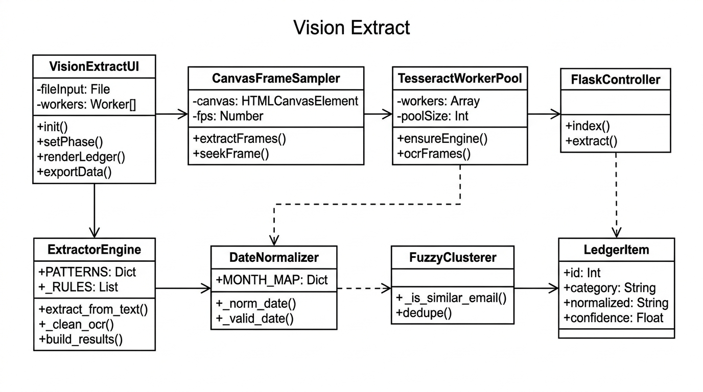
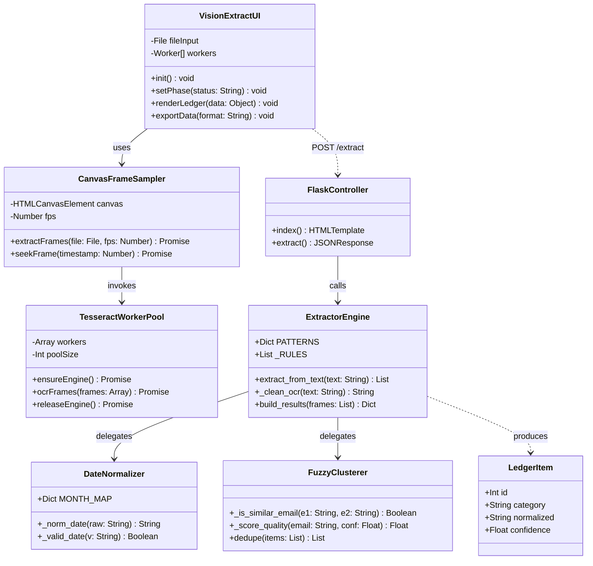
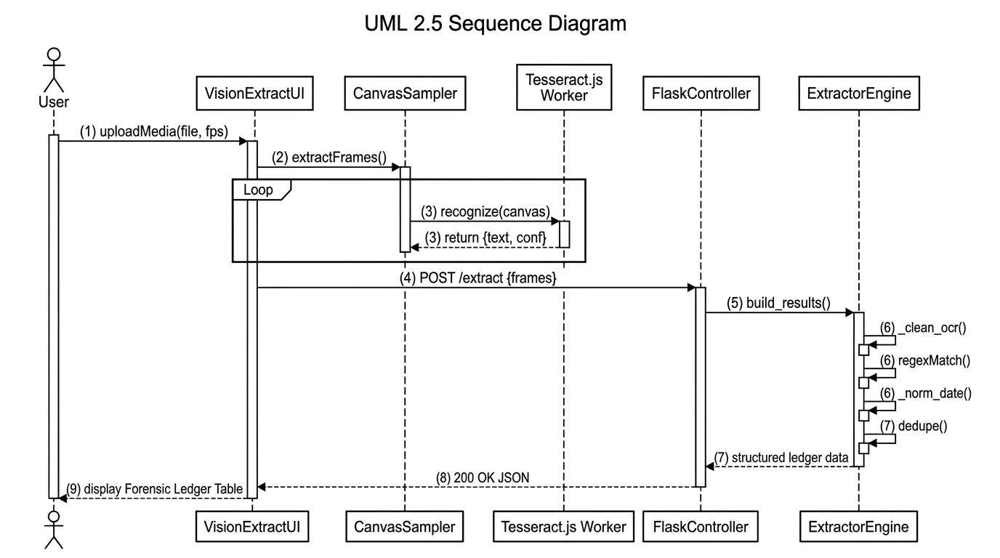
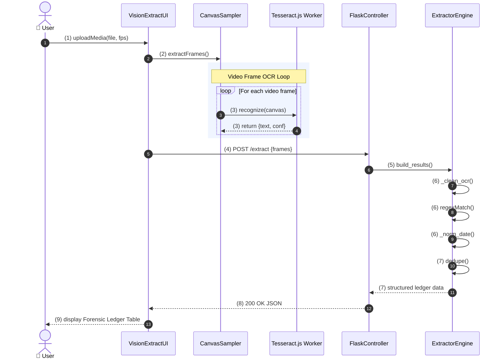

# Vision Extract — UML Diagrams Specification

This document presents the **three core Unified Modeling Language (UML 2.5)** diagrams for Vision Extract, provided as standalone diagrams with their visual architecture diagrams and Mermaid source code.

---

## 1. UML Use Case Diagram

The **Use Case Diagram** captures the system boundary, external actors, and the core functional requirements of the system.

### Visual Diagram

### Specification Details
- **Primary Actor**: `User / Forensic Analyst`
- **System Boundary**: `Vision Extract System`
- **Key Relationships**:
  - `Upload Media` **<<include>>** `Perform In-Browser WASM OCR`
  - `Configure Frame Rate (FPS)` **<<extend>>** `Upload Media`
  - `Perform In-Browser WASM OCR` **<<include>>** `Extract Forensic Entities`
  - `Extract Forensic Entities` **<<include>>** `Normalize Dates (DD/MM/YYYY)`
  - `Extract Forensic Entities` **<<include>>** `Fuzzy Deduplication (Email & UPI)`

### Mermaid Code

---

## 2. UML Class Diagram

The **Class Diagram** defines the object-oriented structure of the application across the browser frontend (JavaScript) and backend engine (Python Flask).

### Visual Diagram

### Class Breakdown
1. **`VisionExtractUI`** (Client Controller): Coordinates user input, DOM elements, progress bar, and ledger rendering.
2. **`CanvasFrameSampler`** (Client): Samples video frames onto an offscreen HTML5 `<canvas>` at the configured FPS.
3. **`TesseractWorkerPool`** (Client OCR): Manages the web worker pool running Tesseract.js WASM.
4. **`FlaskController`** (Backend API): Serves routes `GET /` and `POST /extract`.
5. **`ExtractorEngine`** (Backend): Dispatches text to category pattern matchers and normalizers.
6. **`DateNormalizer`** (Backend): Validates calendar bounds and normalizes to `DD/MM/YYYY`.
7. **`FuzzyClusterer`** (Backend): Clusters and merges OCR corrupted email and UPI variations using `difflib.SequenceMatcher`.
8. **`LedgerItem`** (Data Entity): Represents an extracted data row with category, normalized value, and confidence rating.

### Mermaid Code

---

## 3. UML Sequence Diagram

The **Sequence Diagram** documents the synchronous and asynchronous chronological interactions between components during media processing.

### Visual Diagram

### Interaction Steps
1. **User $\rightarrow$ VisionExtractUI**: Uploads media file and triggers scan.
2. **VisionExtractUI $\rightarrow$ CanvasFrameSampler**: Calls `extractFrames()`.
3. **Loop Block (CanvasSampler $\leftrightarrow$ Tesseract.js Worker)**:
   - Frame rendered to canvas.
   - Worker runs OCR recognition.
   - Per-frame text and confidence returned.
4. **VisionExtractUI $\rightarrow$ FlaskController**: Sends `POST /extract` with JSON payload.
5. **FlaskController $\rightarrow$ ExtractorEngine**: Dispatches `build_results()`.
6. **Internal Engine Self-Calls**:
   - `_clean_ocr()` repairs delimiters and character confusions.
   - Regex rules extract candidate items.
   - `_norm_date()` and `_valid_date()` normalize dates.
   - `dedupe()` performs exact matching and fuzzy clustering.
7. **ExtractorEngine $\rightarrow$ FlaskController**: Returns structured ledger items.
8. **FlaskController $\rightarrow$ VisionExtractUI**: Returns `200 OK` JSON.
9. **VisionExtractUI $\rightarrow$ User**: Renders the interactive Forensic Ledger Table.

### Mermaid Code

